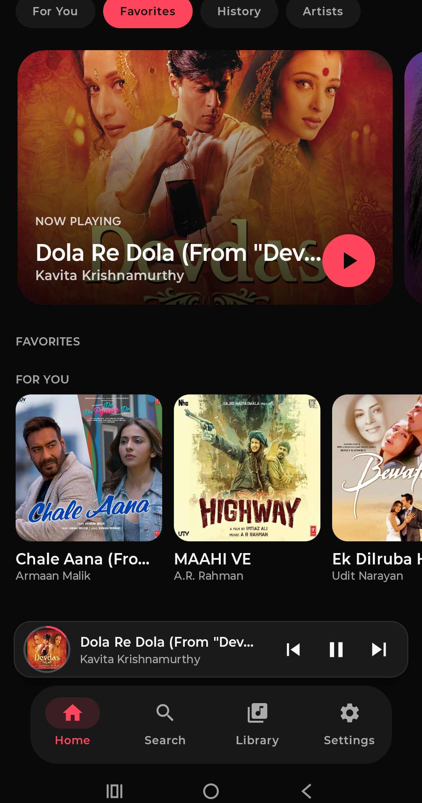
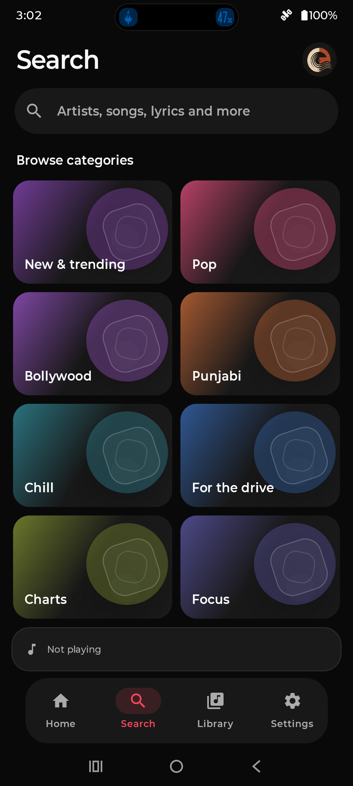

# EchoWave

[](https://github.com/AyushDevHub/EchoWave/actions/workflows/android.yml)
[](https://github.com/AyushDevHub/EchoWave/releases/latest)
[](LICENSE)

EchoWave is an independent Android music player built with Kotlin, Jetpack Compose, and AndroidX Media3. It brings search, discovery, radio-style queues, lyrics, playlists, local audio, and on-device listening insights together in one app. EchoWave is free and open source under GPL-3.0. It is not affiliated with or endorsed by YouTube, Google, or Spotify.

## Download

Get the latest APK from the [EchoWave download page](https://echowave-website.vercel.app/). EchoWave supports Android 8.0 (API 26) and newer. Open the page, tap **Download APK**, then open the downloaded file and tap **Update**. Android may ask you to allow your browser or file manager to install apps; approve that system prompt to continue. Updating over an existing install with the same signing key preserves app data; do not uninstall first.

The app checks GitHub Releases while open and shows an update link when a newer version is available. The link and optional local update notification open the [EchoWave download page](https://echowave-website.vercel.app/), where users can download the APK without browsing GitHub Releases. With notification permission, the app can show a local update notification the next time it is opened. It does not send remote push notifications or silently download or install updates.

## Screenshots

<!-- Screenshots are captured from the app UI and stored in docs/screenshots/. -->

| Home | Search |
| --- | --- |
|  |  |

## Features

### Find and play music

- Search songs, albums, artists, playlists, videos, and episodes, with filters and recent searches.
- Explore charts, moods, and genres; open album track lists and start seed-based radio.
- Build a continuously replenished queue, refresh upcoming recommendations, and use shuffle, repeat, seek, and previous/next controls.
- Browse synchronized lyrics when timing data is available.

### Make it yours

- Choose genres and search for artists during setup or later in Settings. Artist results include artwork where the catalog provides it.
- Personalize recommendations with Music DNA computed on-device from listening activity. Review listening summaries, turn personalization off, or reset the profile.
- Save favorites, playlists, and listening history locally. Import audio you own or are authorized to store through Android's document picker for offline playback.
- Choose from 12 color themes, two fonts, and an optional personalized greeting.

### Android playback

- Background playback through Android Media3, with media session, notification, and lock-screen controls.

## Privacy and usage counts

Listening history, taste signals, favorites, playlists, and imported audio are stored on the device. EchoWave has no account system or app analytics backend and does not report listening activity to the project. The update check contacts GitHub's public release endpoint and exposes normal network metadata such as the device IP; see [Privacy](docs/PRIVACY.md).

The About screen shows the latest APK's public GitHub download count. It counts downloads from GitHub, not APK downloads from the EchoWave website, unique people, successful installs, or current users. EchoWave sends no app-open or listening events to maintainers, so active-use counts are unavailable.

Share feedback or propose a feature through [GitHub Issues](https://github.com/AyushDevHub/EchoWave/issues/new/choose). Do not include personal data, account credentials, cookies, signed URLs, or private listening history in a report.

## Provider and content notice

The current catalog integration uses unofficial, undocumented YouTube/YouTube Music InnerTube endpoints for search, metadata, discovery, and stream resolution. These interfaces can change or stop working. The project has no documented authorization for this access. YouTube's [Terms of Service](https://www.youtube.com/t/terms) and [API Services Developer Policies](https://developers.google.com/youtube/terms/developer-policies) describe restrictions relevant to automated and undocumented access. A disclaimer, open-source license, or another project's implementation does not grant permission. See [provider notes](docs/INNER_TUBE_NOTES.md) and the [risk register](docs/RISK_REGISTER.md).

EchoWave does not host music. Users are responsible for their use of third-party services and for ensuring they have permission to store imported audio. Local audio import is only for files the user selects; it does not download catalog tracks. Artwork, metadata, lyrics, and streams are provided by independent services and rights holders.

## Build from source

Requirements: Android Studio, Android SDK Platform 37, and JDK 17.

```powershell
.\gradlew.bat assembleDebug
.\gradlew.bat test
.\gradlew.bat lint
```

On macOS or Linux, use `./gradlew assembleDebug`, `./gradlew test`, and `./gradlew lint`. See [developer setup](docs/SETUP.md), [architecture](ARCHITECTURE.md), [test plan](docs/TEST_PLAN.md), and [release process](docs/RELEASE_PROCESS.md).

## Project layout

```text
app/src/main/java/com/howdy/echowave/
  core/         shared utilities and error handling
  domain/       models, repository contracts, sources, and recommendations
  data/         local persistence and provider clients
  playback/     Media3 service, session, controller, and queue
  features/     feature boundaries, including listening insights
  ui/           Compose screens, navigation, and theme
```

The UI observes `PlaybackController` state and does not access ExoPlayer directly. `AppContainer` wires repositories, sources, resolvers, and playback.

## Documentation and community

- [Documentation index](docs/INDEX.md) · [Privacy](docs/PRIVACY.md) · [Changelog](docs/CHANGELOG.md)
- [Credits](CREDITS.md) · [Third-party notices](THIRD_PARTY_NOTICES.md) · [Security policy](SECURITY.md)
- [Contributing](CONTRIBUTING.md) · [Support](SUPPORT.md) · [Code of Conduct](CODE_OF_CONDUCT.md)

Please read the project policies before opening an issue or pull request. EchoWave is licensed under the [GNU General Public License v3.0](LICENSE) and is provided without warranty.
